<div align="center">

English | [Deutsch](README.de.md)


# EduFlow

Local school dashboard for EduPage: messages, homework, timetable, grades & more.
NestJS API + Next.js web UI + native Android and macOS apps.

[](LICENSE)

[View Demo](#demo-mode) · [Report Bug](https://github.com/ABOYrbx/eduflow/issues/new?labels=bug) · [Request Feature](https://github.com/ABOYrbx/eduflow/issues/new?labels=enhancement)

</div>

## About

EduFlow is a **local-first school dashboard** on top of EduPage. It provides a
versioned JSON backend (`/api/v1`) with a real EduPage provider plus a fake
provider for demos, a provider-neutral Next.js web UI, and native Android
(Kotlin/Compose) and macOS (SwiftUI) clients. iOS exists but is shelved.

Why EduFlow:

- Your school data stays local — the server is a local tool, never a public deployment
- One API contract for web, Android and macOS (`{items, total, limit, offset}` lists, `{error, code}` errors)
- Demo mode with synthetic data (`demo` / `demo`), so you can try everything without an EduPage account

## Getting Started

### Prerequisites

- Node.js 20.9+ and npm
- PostgreSQL 16 (or let `install.sh` set it up)
- For native builds: Android SDK + Gradle 8.7, or Xcode 16+ on macOS 14+

### Install

```sh
git clone https://github.com/ABOYrbx/eduflow.git
cd eduflow
npm install
./install.sh
```

`install.sh` configures PostgreSQL, generates `apps/api/.env.local` (mode `0600`),
runs Prisma migrations, and never reads or overwrites existing secrets.

### Docker backend (quick start)

For a quick start without a local PostgreSQL setup, use the Docker backend:

```sh
./install-docker.sh            # real mode
./install-docker.sh --demo     # demo mode (login: demo / demo)
./install-docker.sh --stop     # stop the services
```

See [docs/INSTALLATION.md](docs/INSTALLATION.md#docker-backend-recommended-for-quick-start)
for `.env` generation, secrets, ports and the health check. The native
`./install.sh` remains available for a local PostgreSQL/NestJS setup.
### Run with run.sh

```sh
./run.sh            # real mode: API :3000 + Web :8000
./run.sh --demo     # demo mode: API :3100 + Web :8101
./run.sh --background
API_PORT=3001 WEB_PORT=8001 ./run.sh
```

Web: http://localhost:8000 — API: http://127.0.0.1:3000/api/v1

Or run only the backend with Docker: `docker compose up -d` (see [Docker backend](#docker-backend)).

## Demo mode

```sh
./run.sh --demo
```

Sign in with `demo` / `demo`. For two-factor auth: `demo-2fa` / `demo`, code `123456`.
Both real and demo modes can run side by side.

## Docker backend

Run only the backend (API + Postgres) with Docker Compose:

```sh
docker compose up -d
```

The `compose.yml` defines a Postgres service and the API container (built from
`Dockerfile`). The API is exposed on port 3000 by default; set `DEMO=true` for
demo mode. The web UI is not containerized; run it with `./run.sh` or
`npm run dev:web`. Set `JWT_ACCESS_SECRET` and `CREDENTIAL_ENCRYPTION_KEY`
before use; never commit secrets.

## Native apps

- **Android** (`android/`, Kotlin + Compose): default API
  `http://10.0.2.2:3000/api/v1/` (demo `:3100`). Build/test:
  `./gradlew :app:assembleDebug :app:testDebugUnitTest`.
- **macOS** (`mac/`, project `EduFlow Mac`, SwiftUI): default API
  `http://127.0.0.1:3000/api/v1/` (demo `:3100`). Build/test:
  `xcodebuild -project "mac/EduFlow Mac.xcodeproj" -scheme "EduFlow Mac" -destination 'platform=macOS' test`.
- **iOS** (`ios/`): built but shelved.

## Screenshots

### Android

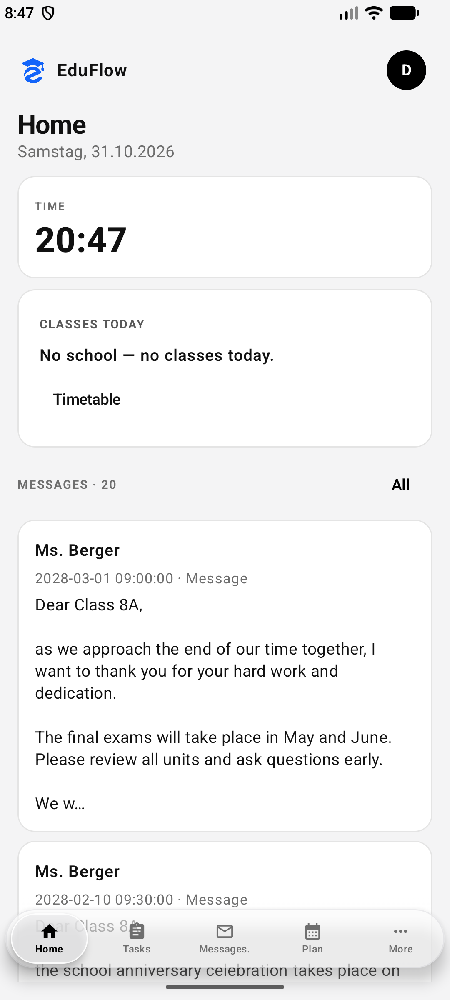
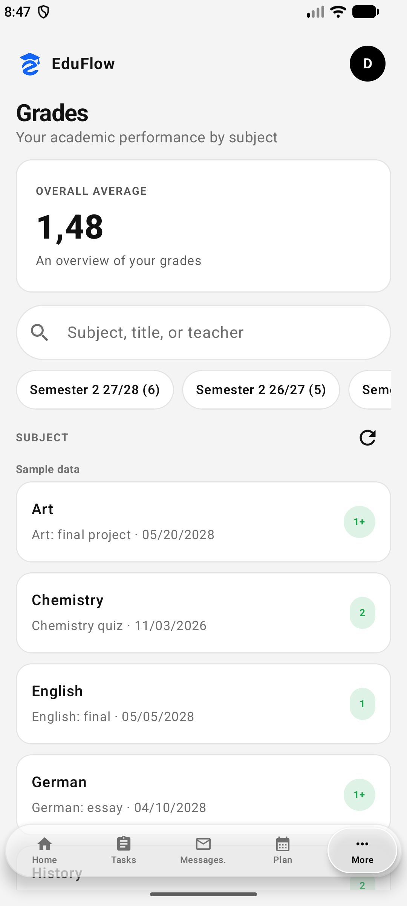
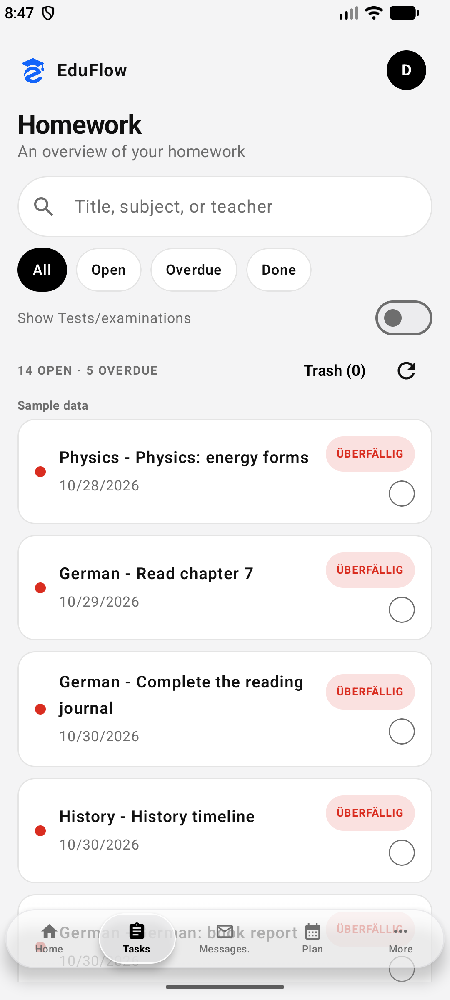
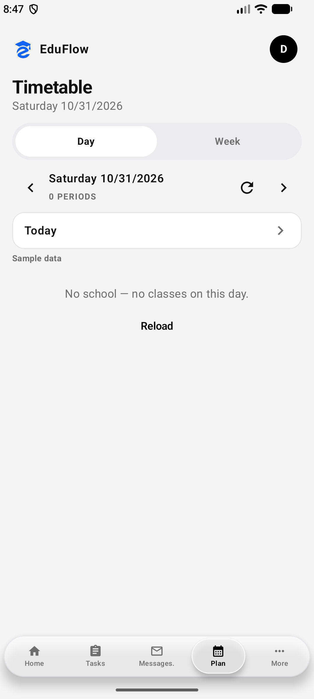
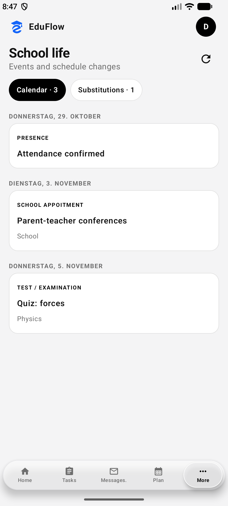
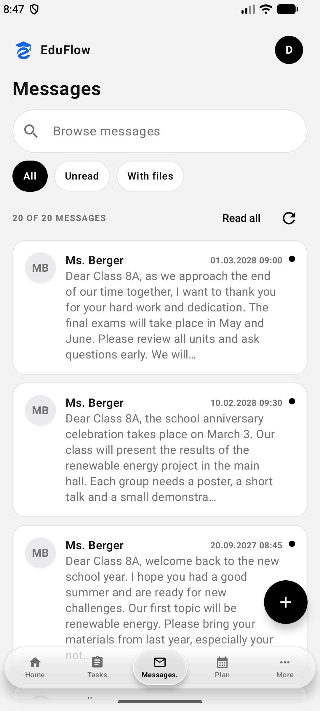
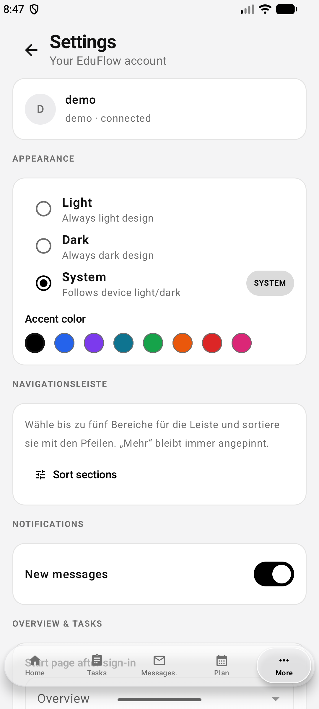
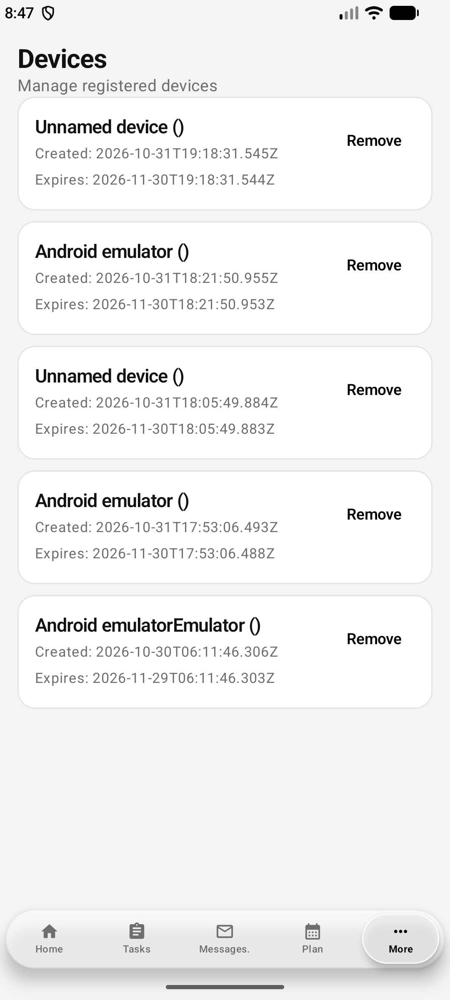
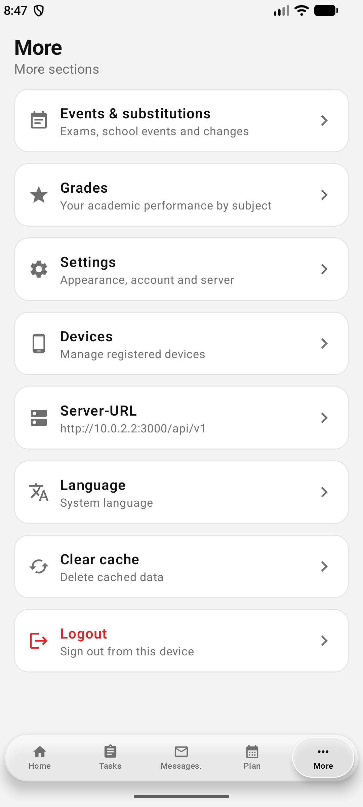

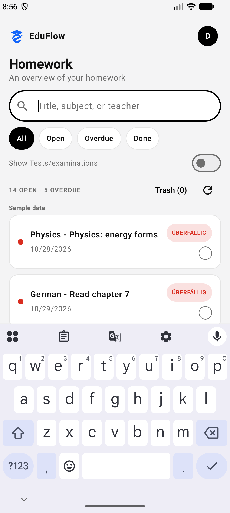
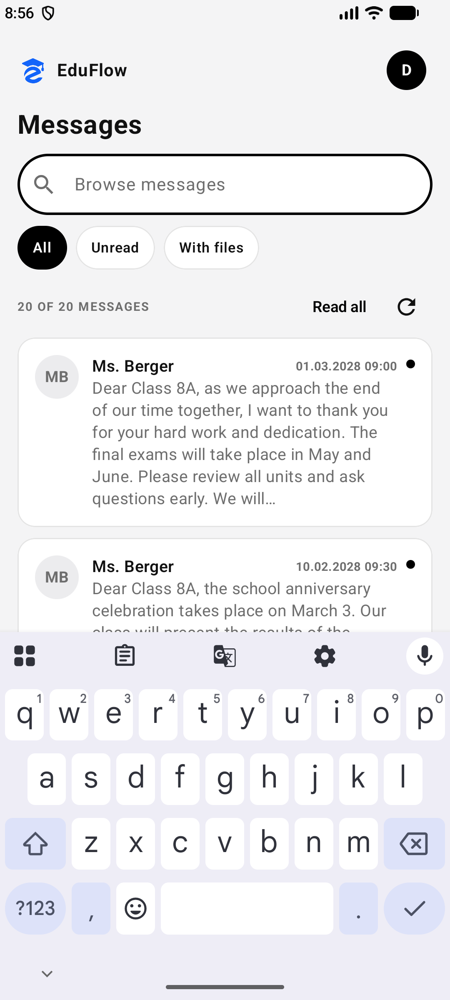

### Web

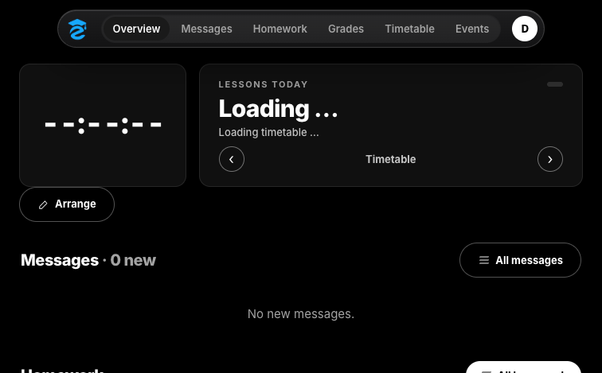
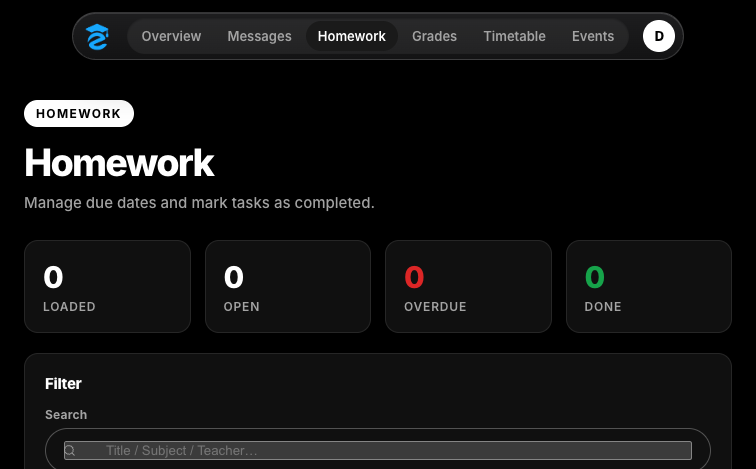
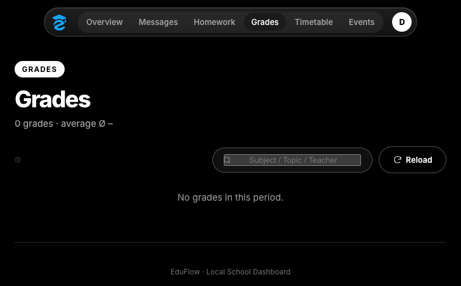
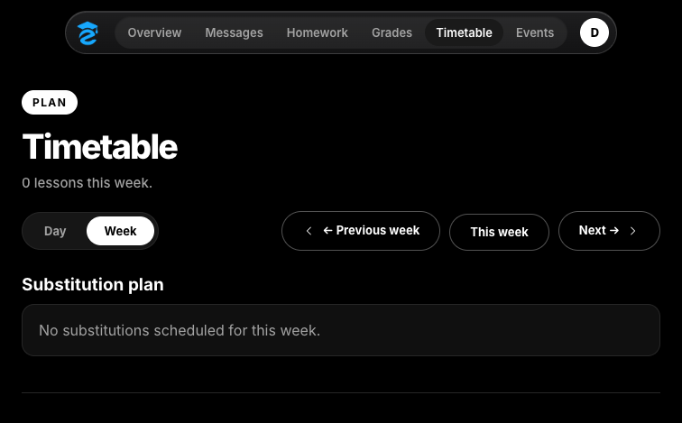
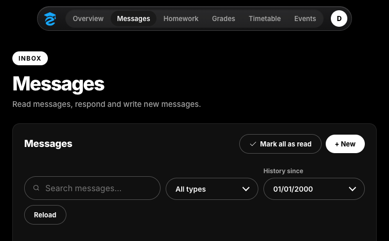
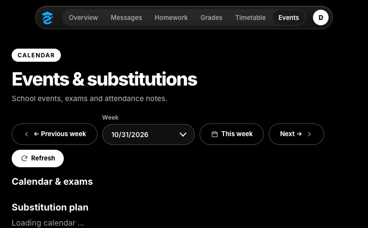
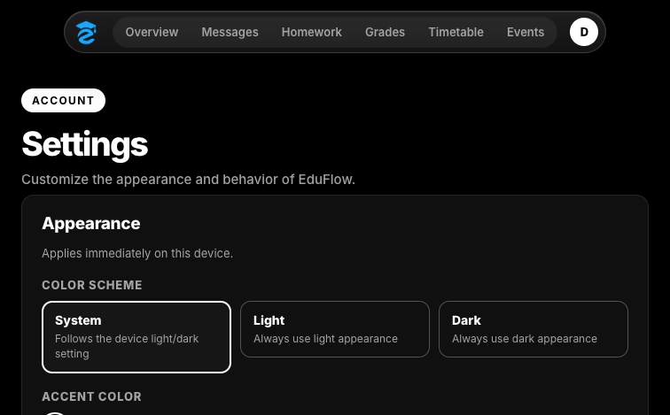
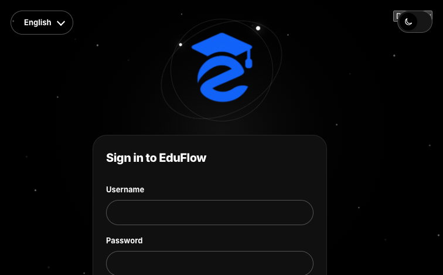

## API reference

Full reference: [docs/API.md](docs/API.md). Quick facts:

- Base: `http://127.0.0.1:3000/api/v1` (demo `:3100`)
- `GET /health` (no auth) and `GET /openapi.json`
- Auth via Bearer token; downloads accept short-lived `?dl=` token
- 2FA two-step: `auth/login` → `2fa_required` + `pending_token`, then `auth/2fa`
- Lists: `{items, total, limit, offset}`; errors: `{error, code}`

## Contributing

1. Fork the project
2. Create a feature branch (`git checkout -b feature/AmazingFeature`)
3. Commit in English
4. Push and open a Pull Request

Keep tests offline (fake provider / fakes / URL stubs, never real credentials)
and run `npm run typecheck` + `npm test` before pushing. Never read, log, or
commit secrets, caches, or login data.

## License

Distributed under the MIT License. See [LICENSE](LICENSE).