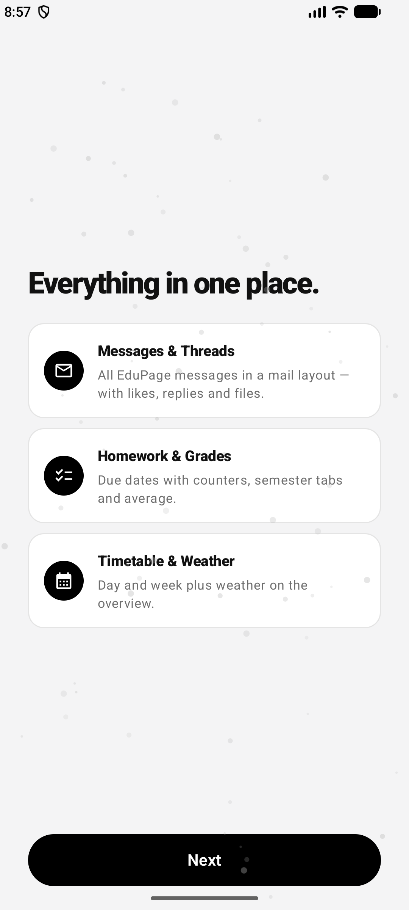
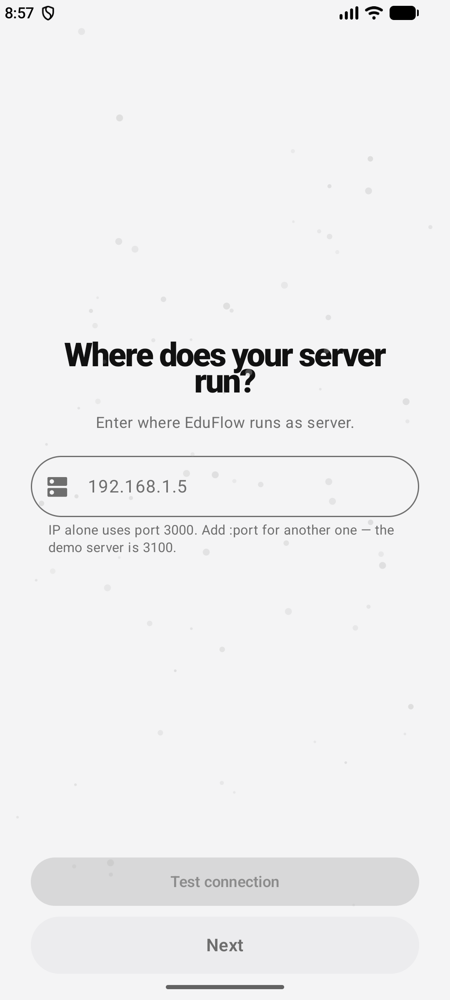

# Screenshots & UI

Screenshots of the Android and web apps, captured with synthetic demo data (`demo` / `demo`). Captions are short descriptions of each screen.

## Android

## Android (additional)

## Web

